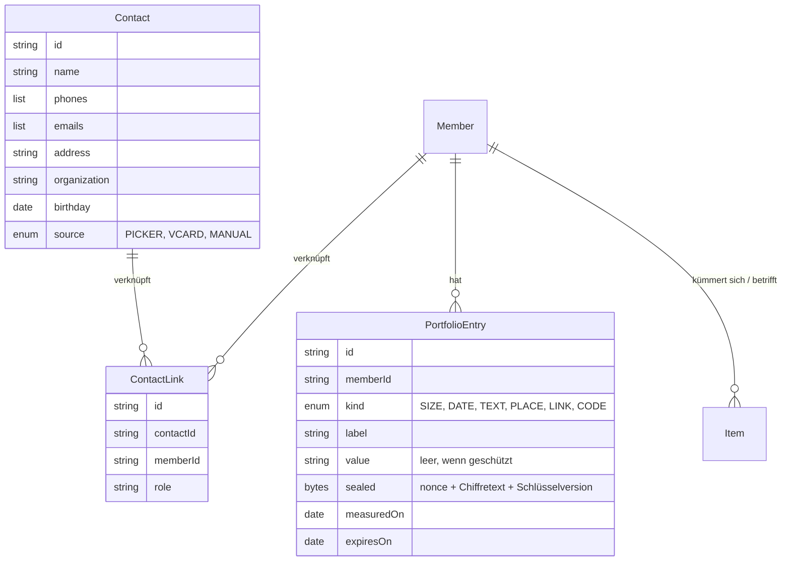

# Gemeinsame Kontakte und Familien-Portfolio – Konzept

- Stand: 27.11.2026 · Status: **Stufe 1 umgesetzt** (Android), Stufe 2 und 3 geplant; siehe [Umsetzungsstand](#umsetzungsstand-stufe-1)
- Anlass: Brainstorming von Nils (27.11.2026)
- Bezug: [KONZEPT.md](KONZEPT.md) (Phase 3 „Optionen finden“, Phase 5 „Zuständigkeit übergeben“), [Gestaltung](gestaltung/optik-haptik-klickwege.md), [ADR 0006](entscheidungen/0006-kopplung-und-abgleich-umsetzung.md) (Abgleich), [Bedrohungsmodell](qualitaet/bedrohungsmodell.md) (neue IDs `KT-` und `TR-`)

Was dieses Konzept anders macht als ein Feature-Brainstorm:

- Die Plattformfragen sind gegen die aktuellen Primärquellen geprüft (Stand 27.11.2026): Android 17 bringt eine eigene Kontaktauswahl, Google Play schränkt `READ_CONTACTS` ab 27.01.2027 ein und `WRITE_CONTACTS` schreibt ab API 38 gar nicht mehr. Daraus folgt eine Architektur ohne Adressbuch-Berechtigung, die heute schon zukunftsfest ist.
- Die Codes (PINs, Spindcodes) bekommen eine echte zweite Schutzstufe mit eigenem Schlüssel und nicht nur einen Sperrbildschirm davor. Der Kniff: Der Abgleich muss Codes nie entschlüsseln, deshalb kann ihr Schlüssel hinter Fingerabdruck oder Gerätesperre liegen, ohne dass der Hintergrundabgleich leidet.
- Es endet mit einer prüfbaren „Übergabeprobe“ statt mit einer Feature-Liste: Kann der andere Elternteil ohne Übergabe einspringen?

**Ziel (Nils, 27.11.2026): Der andere Elternteil kann ohne Übergabe einspringen.** Es gibt kein Übergabegespräch, keine Freigabe und keinen Schritt, den die andere Person vorher erledigen muss. Wer das Portfolio öffnet, sieht alles Nötige und kann jede offene Aufgabe direkt erledigen. „Alles übernehmen“ ist nur nötig, wenn die Zuständigkeit für länger wechseln soll, nicht um handeln zu dürfen.

## Kurzfassung

**Kontakte** kommen einzeln in die App, entweder über die Kontaktauswahl des Systems oder über „Kontakt teilen“ aus dem Telefonbuch. Die App fragt nie nach Zugriff auf das ganze Adressbuch. Ein Kontakt ist eine Kopie, er wird per Abgleich mit allen Familiengeräten geteilt und mit beliebig vielen Familienmitgliedern verknüpft, jeweils mit einer Rolle („Kinderärztin“ für Mia und Ben, „Trainer“ nur für Ben).

Das **Portfolio** ist die Seite einer Person unter *Familie › Person*. Sie zeigt in vier Abschnitten, was man über diese Person wissen muss, um für sie einzuspringen: offene Aufgaben (kümmert sich **oder** betrifft), Kontakte, Infos (Größen, Schule, Ablaufdaten, Ablageorte) und Zugänge & Codes. Codes sind geschützt: verdeckt angezeigt, nur nach Fingerabdruck oder Gerätesperre sichtbar, mit eigenem Schlüssel verschlüsselt, den Kindergeräte nicht bekommen.

## Bezug zum Mental Load

Beide Funktionen zielen auf dasselbe Problem: Familienwissen steckt im Kopf einer Person. Daminger (2019) beschreibt, dass Antizipieren und Überwachen vor allem bei einer Person liegen. Dafür braucht man Wissen, das die andere Person nicht hat: Welche Schuhgröße hat Mia gerade? Wie heißt die Kinderärztin, welche Nummer hat die Praxis? Was steht bei Nils diese Woche noch an? Solange dieses Wissen nicht geteilt ist, kann Zuständigkeit (Phase 5) nicht voll übergeben werden, weil jede Übergabe mit Rückfragen endet. Auch das Pflegen der Beziehungen zur erweiterten Familie und zu Betreuungspersonen („kin-keeping“, di Leonardo 1987, Signs 12(3); aus dem Gedächtnis, vor Zitat prüfen) ist klassisch ungleich verteilt.

| Phase | Was Kontakte und Portfolio beitragen | Messgröße |
| --- | --- | --- |
| 2 Antizipieren | Ablaufdaten (Ausweis, Impfung) und veraltete Größen erzeugen Vorschläge, bevor es dringend wird | Anteil der Ablauffristen, die als Aufgabe ≥ 4 Wochen vorher angelegt wurden |
| 3 Optionen finden | Die Nummer der Praxis, der Trainer, das Elternportal sind einen Tap entfernt | Zeit bis zum Anruf bzw. bis zum geöffneten Portal |
| 5 Zuständigkeit übergeben | Das Portfolio enthält alles, was man zum Einspringen braucht; „Alles übernehmen“ für den Notfall | Rückfragen bei Übergaben (Übergabeprobe, siehe Prüfung) |
| 6 Überwachen | Offene Aufgaben je Person an einem Ort, auch die, die nur „betreffen“ (Kind ohne Handy) | – |

**Risiko, das wir ernst nehmen:** Ein Portfolio ist ein Formular, und Formulare pflegt am Ende die Person, die schon jetzt alles weiß. Dann verschiebt die App den Mental Load in die App, statt ihn zu verteilen (Risiko aus KONZEPT.md). Gegenmittel: Infos entstehen aus dem Erfassen („Mia braucht Schuhe Größe 31“ → Angebot „Schuhgröße übernehmen?“), Vorlagen statt leerer Felder, kein Pflichtfeld, und wir messen, wer pflegt.

## Rohmaterial: Was die Plattformen erlauben (Stand 27.11.2026)

| Quelle | Befund | Folge für uns |
| --- | --- | --- |
| [Android 17 Contact Picker](https://developer.android.com/about/versions/17/features/contact-picker), [Android-Blog 24.03.2026](https://android-developers.googleblog.com/2026/03/contact-picker-privacy-first-contact.html) | `ACTION_PICK_CONTACTS` ab API 37, gewünschte Felder als MIME-Typen (`Phone`, `Email`, `StructuredPostal` …), Mehrfachauswahl, keine Berechtigung; Ergebnis ist eine Sitzungs-URI mit **vorübergehendem** Lesezugriff. Apps mit Ziel-API 37 bekommen für `ACTION_PICK` automatisch die neue Auswahl | Sofort übernehmen und speichern; nur die Felder anfragen, die wir brauchen |
| Android bis 16: `Intent.ACTION_PICK` auf `ContactsContract.Contacts` (Common Intents, „Select a contact“; aus dem Gedächtnis) | Die gewählte Kontakt-URI kommt mit vorübergehendem Leserecht, ebenfalls ohne `READ_CONTACTS` | Gleicher Code-Pfad wie oben, minSdk 26 bleibt |
| [Google-Play-Richtlinie Kontakte](https://support.google.com/googleplay/android-developer/answer/16935362?hl=en-GB) | Ab Ziel-API 37 darf `READ_CONTACTS` nur noch, wer mit der Auswahl nicht auskommt; Pflicht ab 27.01.2027. Teilen, Einladen, einen Kontakt wählen gilt ausdrücklich **nicht** als Grund. `WRITE_CONTACTS` schreibt ab Ziel-API 38 nicht mehr | Wir vertreiben per GitHub-Release (ADR 0004), aber Play bleibt für Abo-Familien eine Option. Keine Adressbuch-Berechtigung, auch kein eigenes Konto im Telefonbuch (Anrufer-Erkennung per SyncAdapter scheidet damit aus) |
| Android: `ContactsContract.Intents.Insert` (aus dem Gedächtnis) | Öffnet die Telefonbuch-App mit vorausgefülltem Kontakt, die Person speichert selbst; keine Berechtigung | „Ins Telefonbuch“ je Kontakt, unabhängig von der `WRITE_CONTACTS`-Änderung |
| Android-Telefonbuch „Kontakt teilen“ | schickt eine vCard (`text/x-vcard` bzw. `text/vcard`) an das Teilen-Ziel | Teilen-Ziel um vCard erweitern, neue Bedrohungen KT-1 bis KT-3 |
| [Apple: Accessing the contact store](https://developer.apple.com/documentation/contacts/accessing-the-contact-store) | Status `limited` (Person gibt einzelne Kontakte frei), `ContactAccessButton`, `contactAccessPicker`; Notizfeld nur mit Entitlement `com.apple.developer.contacts.notes`, das Apple genehmigen muss | Notizen der Kontakte nie lesen. Kein Vollzugriff anfragen |
| Apple: `CNContactPickerViewController` (aus dem Gedächtnis, vor Umsetzung prüfen) | läuft außerhalb des App-Prozesses, App sieht nur die gewählten Kontakte, kein Berechtigungsdialog | iOS-Gegenstück zur Android-Auswahl; vCard kommt zusätzlich über die Share Extension (`public.vcard`) |

### Datenschutz bei Kontaktdaten Dritter

- **Haushaltsausnahme:** Die DSGVO gilt nicht für Verarbeitung „durch natürliche Personen zur Ausübung ausschließlich persönlicher oder familiärer Tätigkeiten“ (Art. 2 Abs. 2 lit. c, Erwägungsgrund 18). Die Nummer der Kinderärztin innerhalb der Familie zu teilen, fällt darunter. Da es keinen Server gibt, verarbeitet auch der Anbieter der App nichts. Einschränkung: Der BGH hat am 17.09.2026 (I ZR 256/25, I ZR 289/25) dem EuGH Fragen zur Reichweite dieser Ausnahme vorgelegt ([beck-aktuell](https://www.beck-aktuell.de/heute-im-recht/rechtsprechung/bgh-izr25625-izr28925-dsgvo-haushaltsausnahme-eugh-vorlage-reichweite-2026-09-17), Sekundärquelle). Die Fälle betreffen Weitergabe an Arbeitgeber und Polizei, also nach außen. Unser Entwurf hält die Daten innerhalb der Familie und ist damit robust, egal wie der EuGH entscheidet.
- **Wo es kritisch wird:** beim Weitergeben an Dritte. Das AG Bad Hersfeld (15.05.2017, F 120/17 EASO, laut [LTO](https://www.lto.de/recht/hintergruende/h/ag-bad-hersfeld-beschluss-f12017easo-whatsapp-nutzung-kontakte-eltern-kontrolle-kinder-bis-volljaherigkeit); als Einzelmeinung eingeordnet) hielt das automatische Hochladen des Adressbuchs an WhatsApp ohne Einwilligung der Kontakte für eine unerlaubte Handlung. Für uns heißt das: (1) Kontaktdaten gehen nie an Cloud-KI oder andere Online-Dienste (KT-4). (2) Wer einen Familienkontakt „ins Telefonbuch“ übernimmt, macht ihn für alle Apps mit Kontaktzugriff lesbar; das geschieht nur einzeln, auf Tap, mit Hinweis (KT-5). (3) Der geteilte Ordner sieht nur Chiffretext (OR-1).
- **Datenminimierung** (Art. 5 Abs. 1 lit. c, als gute Praxis auch ohne Anwendbarkeit): Die Auswahl fragt nur Name, Telefon, Mail, Anschrift, Organisation und Geburtstag ab. Kein Foto, keine Notizen, keine Konto-Daten.
- **Gesundheitsdaten im Portfolio** (Allergien, Krankenkasse): wären nach Art. 9 besonders geschützt, wenn die DSGVO gälte. Sie bleiben in der Familie; wer will, markiert sie wie Codes als „geschützt“.

## Teil 1: Gemeinsame Kontakte

### Wie ein Kontakt hereinkommt

| Weg | Ablauf | Taps (ab geöffneter Quelle) | Berechtigung |
| --- | --- | --- | --- |
| A Aus der App | *Familie › Kontakte › „Aus Telefonbuch“* → Systemauswahl → Kontakt antippen → Kontakt erscheint mit Chip „Für wen?“ | 2 bis zum gespeicherten Kontakt (ab Kontaktliste), +2 zum Verknüpfen (Chip, Person) | keine |
| B Aus dem Telefonbuch | Kontakt öffnen → Teilen → FamilyApp | 3, +2 zum Verknüpfen | keine (Teilen-Ziel) |
| C Aus dem Portfolio | *Person › Kontakte › „+“* → Systemauswahl → Kontakt antippen; Person ist schon verknüpft | 3 inkl. Verknüpfung | keine |
| D Von Hand | *Kontakte › „+“* → Name und Nummer tippen | 2 + Tippen | keine |
| E Später: aus Erfassen | Foto einer Visitenkarte oder eines Kita-Zettels; Texterkennung schlägt einen Kontakt vor | – | Kamera |

- **Speichern ohne Rückfrage** wie beim Erfassen: Der Kontakt ist sofort gespeichert und für alle sichtbar, mit 6 s Rückgängig. Die Verknüpfung mit Personen ist ein Chip am Kontakt, kein Pflichtschritt („schnell rein, komplett später“). Unverknüpfte Kontakte stehen unter „Familie allgemein“ (Handwerker, Hausverwaltung) und sind ausdrücklich erlaubt.
- **Mehrfachauswahl** (Android 17, iOS) ist erlaubt, aber höchstens 20 Kontakte je Vorgang. Das ganze Adressbuch hineinzukippen, macht die Liste unbrauchbar und widerspricht „nur familienrelevante Kontakte“ aus KONZEPT.md.
- **Dubletten:** Gleiche Telefonnummer (normalisiert: Ziffern, führende 0 → +49) oder gleiche Mail → wird zusammengeführt. Neue Nummern und Adressen kommen dazu, nichts Vorhandenes wird überschrieben; die Rückmeldung sagt „Mit vorhandenem Kontakt Dr. Lindner zusammengeführt“, Rückgängig stellt den alten Stand her. (Abweichung vom ersten Entwurf, der ein Angebot zum Zusammenführen vorsah: Mit Rückgängig ist automatisches Zusammenführen genauso sicher und spart einen Tap.)

### Verknüpfung n:m mit Rolle

Die Rolle hängt an der Verknüpfung, nicht am Kontakt: Dr. Lindner ist Kinderärztin für Mia und Ben, aber nicht für die Erwachsenen. Rollen sind freie Wörter mit Vorschlägen aus einer kurzen Liste (Kinderärztin, Zahnarzt, Hausarzt, Klassenlehrerin, Erzieherin, Hort, Trainer, Eltern von Freund/in, Babysitter, Notfall). Regeln schlagen die Rolle vor („Praxis“, „Dr. med.“, „Kinder- und Jugendarzt“ in der Organisation → Arzt), ein Mensch bestätigt.

**Kontakte speisen die Regel-Engine, aber nur als Vorschlag.** Ist die Mailadresse der Klassenlehrerin mit Mia verknüpft, schlägt eine Mail von ihr „betrifft Mia“ vor. Direkt zugewiesen wird nicht: Genau diese Regel hat im Regel-Spike die zwei Falschzuweisungen erzeugt (Lehrerin schreibt schulweite Rundmails). Harte Merkmale bleiben die Ausnahme wie bisher.

### Ein Kontakt in der App

- Oben Name, Organisation, darunter die Verknüpfungen als Personen-Punkte mit Initiale und Rolle („M Kinderärztin · B Kinderärztin“).
- Aktionen als große Knöpfe: **Anrufen** (öffnet die Wähl-App mit der Nummer, ruft nicht selbst an: `ACTION_DIAL`, keine `CALL_PHONE`-Berechtigung), **Nachricht**, **Mail**, **Route** (Adresse an die Karten-App), **Ins Telefonbuch**.
- Darunter: offene Aufgaben, in deren Text der Kontakt vorkommt (Name oder Organisation), z. B. „U9 bei Dr. Lindner vereinbaren“. Das ist eine Suche, keine gepflegte Verknüpfung; eine echte Verknüpfung Aufgabe ↔ Kontakt kommt erst in Stufe 3.
- Geburtstag (falls vorhanden) erscheint in *Demnächst* als vorausgedachter Eintrag ohne Zuständigkeit. Das ist die einzige pflegefreie „emotionale Arbeit“, die KONZEPT.md behält.
- „Zuletzt geändert von Lisa, 12.11.“ klein unten (Transparenz, `changedBy`).

### Kopie statt Live-Verbindung

Ein geteilter Kontakt ist eine Kopie. Ändert sich die Nummer im Telefonbuch, ändert sie sich in der App nicht von selbst. Begründung: Eine Live-Verbindung bräuchte `READ_CONTACTS` (Play-Richtlinie, siehe oben) und dauernden Hintergrundzugriff, und bei zwei Handys mit verschiedenen Telefonbüchern wäre unklar, welche Fassung gilt. Aktualisieren heißt: Kontakt erneut teilen; die Dublettenerkennung bietet dann „Nummer von Dr. Lindner aktualisieren?“ an.

In die andere Richtung übergibt **Ins Telefonbuch** einen Familienkontakt einmalig an die Telefonbuch-App, die Person speichert dort selbst. Damit klingelt das Handy mit „Dr. Lindner“ statt mit einer Nummer. Hinweis beim ersten Mal: „Im Telefonbuch können auch andere Apps (z. B. Messenger) diesen Kontakt lesen.“

## Teil 2: Portfolio

### Wo es liegt und wie man hinkommt

*Familie › Person antippen* (Personen-Punkt oder Balken der Lastkarte, lange drücken bzw. „Portfolio“ im Filter) → Portfolio. Das sind **2 Taps ab Start**, wie K4 „Lisas Stapel ansehen“ aus der Gestaltung. Kein neuer Tab: Die Navigationsleiste ist mit fünf Zielen voll (D1). Das eigene Portfolio erreicht man zusätzlich über den eigenen Avatar.

Auf dem Tablet (Variante C, später) ist das Portfolio die Spalte der Person.

### Vier Abschnitte

| # | Abschnitt | Inhalt | Woher |
| --- | --- | --- | --- |
| 1 | **Offen** | Alle offenen Aufgaben, bei denen die Person *kümmert sich* **oder** *betrifft* ist, Überfälliges zuerst und rot mit Text. Darunter Eingangskarten, die die Person betreffen, aber noch keinen Zuständigen haben. Für Kinder ohne Handy ist „betrifft“ der Normalfall | vorhandene Felder `assignee`, `concerns` im Datenmodell |
| 2 | **Kontakte** | Verknüpfte Kontakte mit Rolle, Anrufen direkt in der Zeile | Teil 1 |
| 3 | **Infos** | Größen, Schule/Klasse, Allergien, Ablaufdaten, Ablageorte („Impfpass: Ordner Gesundheit, Schreibtisch“), Links (Elternportal, Vereinsseite) | Vorlagen je Personenart, Erfassen-Vorschläge, von Hand |
| 4 | **Zugänge & Codes** | Fahrradschloss, Spind, Tresor im Hotel, Benutzername fürs Portal; verdeckt, siehe Teil 3 | von Hand |

Die Reihenfolge folgt dem Notfall: Wer einspringt, braucht zuerst „was ist offen“, dann „wen rufe ich an“, dann Fakten, ganz zuletzt Codes.

### Notfall: „Alles übernehmen“

Zum Einspringen braucht es keinen Knopf: Jede Aufgabe im Portfolio lässt sich direkt erledigen, auch wenn jemand anderes „kümmert sich“ ist, und alle sehen, wer sie erledigt hat. Im Abschnitt *Offen* steht zusätzlich der Knopf **„Alles von Nils übernehmen“** für den Fall, dass die Zuständigkeit für länger wechselt. Ein Tap setzt dich als „kümmert sich“ bei allen offenen Aufgaben dieser Person, zeigt 6 s Rückgängig und für alle sichtbar „Lisa hat 7 Aufgaben von Nils übernommen“. Einzelne Aufgaben kann man danach zurückgeben. Das macht das Portfolio vom Nachschlagewerk zum Notfallplan, denn Wissen allein übergibt keine Zuständigkeit (Phase 5). Kein heimliches Übernehmen, wie bei „Übernehme ich“.

### Infos: getippt, datiert, mit Ablauf

Freie Felder veralten unbemerkt, besonders Kindergrößen. Deshalb hat jede Info einen **Typ**:

| Typ | Beispiel | Besonderheit |
| --- | --- | --- |
| Größe | Schuhgröße 31, Kleidergröße 128 | speichert „gemessen am“; bei Kindern nach 4 Monaten der Hinweis „noch aktuell?“ beim Öffnen des Portfolios (nie als Benachrichtigung, Prämisse 26.11.) |
| Datum mit Ablauf | Personalausweis gültig bis 03/2029, Tetanus-Auffrischung | erzeugt 8 Wochen vorher (einstellbar) einen **Vorschlag** im Eingang: „Ausweis von Nils läuft am … ab“, mit Person als „betrifft“; HITL wie jede Karte |
| Text | Klasse 2b, Allergie: Nüsse | – |
| Ort | Impfpass: Ordner Gesundheit | beantwortet „wo liegt …?“, das häufigste Rückfrage-Thema im Notfall |
| Link | Elternportal, Vereinsseite | nur `http(s)://` (wie TE-8), öffnet im Browser |
| Code | Spind 4-stellig, Fahrradschloss | immer geschützt, siehe Teil 3 |

**Vorlagen statt leerer Felder:** Für Kinder stehen Schuhgröße, Kleidergröße, Schule/Klasse, Allergien, Impfpass-Ort als graue Platzhalter da („Schuhgröße – antippen zum Eintragen“), für Erwachsene Ausweis, Führerschein, Kleidergröße. Leere Vorlagen zählen nicht als „unvollständig“, es gibt keinen Fortschrittsbalken (keine Gamification, Gestaltung).

**Aus dem Erfassen:** Erkennt die Regel-Engine in einem Eintrag Person + Größenwort + Zahl („Mia braucht Turnschuhe Größe 31“), bietet die Rückmeldung nach dem Speichern „Schuhgröße Mia: 31 merken?“ an, so wie „Künftig immer so?“. Ignorieren ist richtig.

## Teil 3: Geschützte Einträge (Codes, PINs, Zugänge)

### Was eine zusätzliche Schutzstufe braucht, und was nicht hineingehört

Heute liegen alle Familiendaten unverschlüsselt im privaten App-Speicher; geschützt sind sie durch die Android-Sandbox und die Bildschirmsperre, unterwegs durch den Familienschlüssel. Für Kindergrößen reicht das. Für Codes nicht, aus vier Gründen:

1. **Geliehenes, entsperrtes Handy** (Kind spielt, Oma telefoniert): Die Sandbox schützt nicht vor dem, der gerade das entsperrte Handy hält.
2. **Kindergeräte:** Kinder sind im Datenmodell vorgesehen (`MemberKind.CHILD`, `hasDevice`). Ein Kind soll seinen eigenen Spindcode sehen, aber nicht den Code des elterlichen Fahrradschlosses oder den Zugang zum Elternportal.
3. **Verlorenes Handy und ehemalige Familienmitglieder** (GE-1, höchstes Restrisiko): Wer den Familienschlüssel hat, liest alles, auch über den geteilten Ordner. Codes sollten daran nicht hängen.
4. **Bildschirm:** Screenshots, Vorschau der letzten Apps, Zwischenablage.

**Nicht hinein gehören Passwörter, Bank- und Karten-PINs.** Ein Passwortmanager (Bitwarden, KeePassXC, 1Password mit Familienfreigabe) kann Autofill, Sicherheitsprüfungen und hat geprüfte Krypto; eine Familien-App wäre ein schlechter Passwortmanager mit größerer Angriffsfläche. Karten-PINs verbieten zudem die Bedingungen der Banken aufzuschreiben (Sorgfaltspflichten; Wortlaut je Bank prüfen). Für Portale speichert das Portfolio deshalb Link + Benutzername + „Passwort im Passwortmanager unter …“. Enthält die Bezeichnung „Passwort“, „Kennwort“ oder „PIN Karte“, zeigt die App einen Hinweis darauf, ohne zu verbieten.

### Der Kniff: Codes müssen für den Abgleich nie entschlüsselt werden

Der Familienschlüssel liegt ungeschützt in `sync.json`, weil der Abgleich im Hintergrund ohne Menschen laufen muss (ADR 0006). Codes reisen aber als fertiger Chiffretext im Datensatz mit; kein Gerät muss sie zum Abgleichen öffnen. Deshalb kann ihr Schlüssel hinter Fingerabdruck oder Gerätesperre liegen, ohne dass Abgleich, Sicherung oder Hausgerät etwas davon merken.

### Schlüssel

```text
Tresor-Hauptschlüssel  (256 Bit, einmal je Familie, nur auf Geräten von Erwachsenen)
   └─ HKDF(Hauptschlüssel, "familyapp-tresor-v1:" + memberId)  →  Personenschlüssel je Portfolio
        └─ AES-256-GCM, AAD = entryId | memberId | Schlüsselversion  →  versiegelter Wert im Datensatz
```

- **Wer bekommt was:** Geräte von Erwachsenen bekommen beim Koppeln den Hauptschlüssel und können jedes Portfolio öffnen (Transparenz unter Erwachsenen bleibt). Das Gerät eines Kindes bekommt beim Koppeln nur seinen eigenen Personenschlüssel und sieht nur die eigenen Codes. Das Hausgerät bekommt keinen Tresorschlüssel; es gleicht Chiffretext ab.
- **Warum abgeleitet statt je Person zufällig:** Kommt eine neue Person dazu, muss kein Schlüssel nachverteilt werden; jedes Erwachsenengerät leitet ihn selbst ab. Schlüssel nachverteilen ginge über den Abgleich nur mit Geräteschlüsseln (M4), die es noch nicht gibt.
- **Verteilt wird nur beim Koppeln**, in der `Welcome`-Nachricht nach beiden „Stimmt“ (KO-5). Ob ein Gerät den Hauptschlüssel bekommt, entscheidet die Personenart, die das einladende Gerät beim Koppeln sieht. Ein Kindergerät kann sich später nicht selbst zum Erwachsenen machen, weil der Hauptschlüssel nie über den Abgleich läuft.
- **Sicherung:** Die Sicherung (bereits mit dem Wiederherstellungscode verschlüsselt, P0-3) enthält den Schlüssel, den dieses Gerät hat. Sonst wären Codes nach einem Handyverlust weg, wenn kein zweites Erwachsenengerät existiert.
- **Auf dem Gerät:** Der Hauptschlüssel liegt in `sync.json` nur eingewickelt mit einem Schlüssel aus dem Android Keystore, der Nutzer-Authentisierung verlangt: ab API 30 `setUserAuthenticationParameters(300, AUTH_BIOMETRIC_STRONG or AUTH_DEVICE_CREDENTIAL)`, darunter `setUserAuthenticationValidityDurationSeconds(300)`. Abfrage über `androidx.biometric.BiometricPrompt`. iOS: Schlüsselbund mit `SecAccessControl(.userPresence)` und `kSecAttrAccessibleWhenPasscodeSetThisDeviceOnly` (nicht im iCloud-Schlüsselbund).
- **Ohne Bildschirmsperre** (`KeyguardManager.isDeviceSecure() == false`) gibt es keinen Schutz zu verwalten: Codes zeigt die App dann nicht, sondern „Für Codes braucht dieses Handy eine Bildschirmsperre“ mit Knopf zu den Einstellungen. Wird die Sperre entfernt, verwirft Android den Keystore-Schlüssel; die App holt den Tresorschlüssel dann aus der Sicherung oder durch erneutes Koppeln.
- **Schlüsselwechsel:** M1 (Gerät entfernen) muss den Tresor-Hauptschlüssel mitwechseln und alle Codes neu versiegeln. Das Feld „Schlüsselversion“ ist dafür von Anfang an im Format.

### Bedienung

| Schritt | Verhalten |
| --- | --- |
| Portfolio öffnen | Codes stehen als „Spind Schule · ••••“, Bezeichnung lesbar, Wert verdeckt |
| Wert antippen | einmal Fingerabdruck oder Gerätesperre, danach 5 Minuten lang ohne Nachfrage für alle Codes; Wert 30 s sichtbar |
| Solange ein Wert sichtbar ist | `FLAG_SECURE` (kein Screenshot, leere Vorschau in den letzten Apps), iOS: Inhalt beim Wechsel in den Hintergrund abdecken |
| Kopieren | `ClipDescription.EXTRA_IS_SENSITIVE` (Android 13+, Wert erscheint nicht in der Kopiervorschau), Zwischenablage nach 60 s leeren |
| Ändern | alter Wert bleibt 30 Tage als „vorher“ sichtbar (im selben versiegelten Datensatz), weil ein geänderter Spindcode sonst niemandem mehr bekannt ist |
| Nie | Codewerte in Benachrichtigungen, in der Suche (nur Bezeichnungen sind suchbar), im Notfallblatt ohne ausdrückliche Auswahl, an Cloud-KI |

Jede Info kann zusätzlich als **geschützt** markiert werden (z. B. Krankenkasse, Allergien, wenn gewünscht). Codes sind immer geschützt.

## Datenmodell

Wie bei der Kochbibliothek: neue Datensatzarten als zusätzliche Felder in `FamilyData`, jeder Datensatz mit `Stamp`, Löschen als neue Fassung mit `deleted`. Das Schema bleibt 2, ältere App-Versionen gleichen alles andere weiter ab und überspringen nur die neuen Felder.



Jede Datensatzart trägt außerdem `deleted`, `changedBy` und `stamp`.

Zwei Entscheidungen, die aus dem Abgleich folgen:

1. **`ContactLink` ist ein eigener Datensatz**, keine Liste im Kontakt. Der Abgleich entscheidet pro Datensatz, neuerer Stempel gewinnt ganz (ADR 0006). Stünden die Verknüpfungen im Kontakt, würde Lisas „auch für Ben“ verloren gehen, wenn Nils gleichzeitig die Nummer ändert.
2. **Je Info ein Datensatz** aus demselben Grund: Schuhgröße und Kleidergröße werden oft gleichzeitig auf zwei Handys gepflegt (nach dem Einkauf).

Wird ein Familienmitglied gelöscht, bleiben Kontakte erhalten, Verknüpfungen und Portfolio-Einträge der Person werden mit gelöscht (gleiche Rückgängig-Logik wie bei Aufgaben).

## Empfehlungen

Nils' Regel: Was nicht kommentiert wird, gilt als angenommen.

| # | Empfehlung | Verworfen, weil |
| --- | --- | --- |
| E1 | **Keine Adressbuch-Berechtigung.** Kontakte nur einzeln über Systemauswahl oder Teilen; `READ_CONTACTS` und `WRITE_CONTACTS` stehen nie im Manifest, `verify-apk.sh` prüft das | Vollzugriff: Play-Richtlinie ab 27.01.2027, `WRITE_CONTACTS` ab API 38 wirkungslos, widerspricht Datenminimierung |
| E2 | **Kopie statt Live-Verbindung**, „Ins Telefonbuch“ je Kontakt über den System-Dialog | Zwei-Wege-Abgleich mit dem Telefonbuch: braucht Berechtigungen, Konflikte zwischen Handys |
| E3 | **Rolle an der Verknüpfung**, Kontakte ohne Person erlaubt („Familie allgemein“) | Rolle am Kontakt: eine Ärztin hat für verschiedene Kinder dieselbe, aber nicht für alle Personen eine Rolle |
| E4 | **Verknüpfte Kontakte als Regelquelle nur für Vorschläge** | Direkte Zuweisung: Spike zeigte Falschzuweisungen durch Rundmails |
| E5 | **Portfolio unter Familie › Person**, vier Abschnitte in Notfall-Reihenfolge; *Offen* = kümmert sich **oder** betrifft | Eigener Tab: Leiste voll (D1); nur „kümmert sich“: Kinder ohne Handy hätten ein leeres Portfolio |
| E6 | **„Alles übernehmen“** als Sammelaktion mit Rückgängig, für alle sichtbar | Nur Ansicht: Wissen übergibt keine Zuständigkeit |
| E7 | **Infos mit Typ**: Größen mit Datum und „noch aktuell?“ beim Öffnen, Ablaufdaten als Vorschlag im Eingang, Vorlagen ohne Fortschrittsbalken | Freie Felder: veralten unbemerkt; Benachrichtigung für „noch aktuell?“: Prämisse 26.11. |
| E8 | **Codes mit eigenem Tresorschlüssel**: Hauptschlüssel nur auf Erwachsenengeräten, Personenschlüssel per HKDF, Entsperren per Biometrie oder Gerätesperre für 5 Minuten, verdeckt, `FLAG_SECURE`, sensible Zwischenablage | Nur Sperrbildschirm vor der Ansicht: schützt nicht vor Kindergeräten, Ordnerzugriff mit Familienschlüssel und Datei im App-Speicher; eigener PIN in der App: noch ein Geheimnis zum Merken |
| E9 | **Keine Passwörter und Bank-PINs**, Verweis auf Passwortmanager, Hinweis bei verdächtiger Bezeichnung | Eingebauter Passwortmanager: schlechter als vorhandene, große Angriffsfläche |
| E10 | **Kontakte und Portfolio gehen nie an Cloud-KI**, auch nicht, wenn sie für Rezepte eingeschaltet ist | – |
| E11 | **Codes erst mit dem Tresor ausliefern** (Stufe 2). Stufe 1 bietet den Typ „Code“ noch nicht an | Codes zuerst ungeschützt: Familien tragen sie ein und sie liegen dann im Klartext in alten Sicherungen |

## Umsetzung in Stufen

| Stufe | Inhalt | Abnahmekriterien |
| --- | --- | --- |
| 1 | Kontakte (Systemauswahl Android, Teilen einer vCard, von Hand), Verknüpfung mit Rolle, Kontaktansicht mit Anrufen/Mail/Route/Ins Telefonbuch, Kontakte in *Suchen*. Portfolio mit *Offen*, *Kontakte*, *Infos* (ohne Code), „Alles übernehmen“ | Kontakt aus dem Telefonbuch gespeichert und mit einer Person verknüpft in ≤ 4 Taps ab Kontaktliste (Weg A) bzw. 3 ab Portfolio (Weg C), ohne Berechtigungsdialog (Emulator-Test, API 26 und 36). APK ohne `READ_CONTACTS`/`WRITE_CONTACTS` (`verify-apk.sh`). Kontakt und Verknüpfung kommen per Abgleich auf dem Hausgerät an |
| 2 | Tresor und Codes, „geschützt“ für Infos, Größen-Aktualität, Ablaufdaten als Vorschläge, Erfassen-Vorschlag „Schuhgröße merken?“ | Unit-Tests: Kindergerät öffnet fremde Codes nicht, Ordner und Hausgerät sehen keinen Codewert, Sicherung stellt Codes wieder her, AAD verhindert das Umhängen eines Codes an eine andere Person. Emulator: Codewert erst nach Gerätesperre sichtbar, `FLAG_SECURE` gesetzt |
| 3 | Notfallblatt drucken je Person (System-Druckdienst, ohne Codes außer ausdrücklich gewählt), echte Verknüpfung Aufgabe ↔ Kontakt, Kontakt aus Foto, iOS-Gegenstücke | Übergabeprobe (unten) besteht |

Stufe 1 braucht für die Datenschicht keine neue Bibliothek.

### Umsetzungsstand Stufe 1

Umgesetzt (27.11.2026):

- **Kontakte:** Systemauswahl (`ACTION_PICK` auf Telefonnummern), „Kontakt teilen“ als vCard (2.1, 3.0, 4.0 mit Quoted-Printable und Umlauten, wie es die Android-Kontakte-App schreibt), Formular. Speichern sofort mit Rückgängig, Dubletten werden zusammengeführt (siehe oben). Kontaktseite mit Anrufen, SMS, Mail, Route, „Ins Telefonbuch“ und „Offene Aufgaben dazu“ (Titel nennt Name oder Organisation, eine Suche, keine gespeicherte Verknüpfung). Kontakte in *Suchen*, auch nach Rolle und Nummer ohne Leerzeichen. Einstieg unter *Familie* als Karte wie die Kochbibliothek.
- **Verknüpfung:** n:m mit Rolle je Verknüpfung; Rolle wird aus Organisation und Name vorgeschlagen (Regeln, kein KI), Vorlagen als Chips. Aus dem Portfolio angelegte Kontakte sind sofort mit der Person verknüpft.
- **Portfolio:** Tap auf eine Person unter *Familie* öffnet es („Ändern“ für Name und Farbe ist daneben). Abschnitte *Offen* (kümmert sich oder betrifft, mit Datum zuerst; Eingangskarten darunter), *Kontakte*, *Infos* mit Vorlagen je Personenart und den Typen Größe, Datum, Text, Ablageort, Link. Kindergrößen älter als 120 Tage zeigen „Noch aktuell?“ mit „Stimmt noch“ (aus Stufe 2 vorgezogen, ohne Benachrichtigung). „Alles übernehmen“ mit einem Rückgängig für alle.
- **Abgleich und Sicherung:** Kontakte, Verknüpfungen und Infos sind eigene Datensätze im Abgleich (neuerer Stand gewinnt je Datensatz); Löschen leert die Felder und behält eine Markierung. Ältere App-Versionen überspringen die neuen Felder. Beim Beitritt zu einer Familie werden eigene Kontakte und Infos auf die Personen der Familie umgehängt. Das Hausgerät baut mit demselben Code.
- **Prüfung:** Unit-Tests `VCardTest`, `ContactRulesTest`, `ContactRepositoryTest`, `ContactSyncTest`, `PeopleModelTest`, `SharedInputTest` (vCard); `verify-apk.sh` lehnt `READ_CONTACTS`, `WRITE_CONTACTS` und `CALL_PHONE` ab.

Abweichungen und Grenzen:

- **Systemauswahl vor Android 17 liefert nur Name und eine Nummer.** Ohne `READ_CONTACTS` gibt `ACTION_PICK` ein vorübergehendes Leserecht nur auf die gewählte Zeile (eine Telefonnummer). Mail, Adresse und Geburtstag kommen über „Kontakt teilen“ oder das Formular. Die Kontaktauswahl von Android 17 (`ACTION_PICK_CONTACTS`, Mehrfachauswahl) folgt, wenn die App auf API 37 zielt.
- **Noch offen aus den Abnahmekriterien:** Emulator-Test der Taps (Weg A ≤ 4, Weg C ≤ 3) und Teilen einer vCard im Emulator-Teilen-Test (KT-1). Beides braucht die CI und kommt als eigener Schritt.
- Kein „Hinweis beim ersten Mal“ für „Ins Telefonbuch“ (KT-5): Der Hinweistext steht dauerhaft unter dem Knopf. Stufe 2 braucht `androidx.biometric` (Google Maven, in der Cloud-Session nicht ladbar, also nur in der CI prüfbar wie der übrige Compose-Code).

## Prüfung: Übergabeprobe

Was außer uns zeigt, dass es wirkt: eine Probe, die die Lage im Notfall nachstellt.

1. **Vorher** (ohne App, in der Tagebuchstudie Woche 1): Der weniger belastete Elternteil beantwortet ohne Rückfrage fünf Fragen über die andere Person und ein Kind, z. B. Schuhgröße des Kindes, Nummer der Kinderarztpraxis, welche Fristen die andere Person diese Woche hat, Spindcode des Kindes, Adresse des Elternportals. Gemessen: richtige Antworten und Zeit.
2. **Nachher** (Woche 5, mit App): dieselben Fragen mit neuen Werten.
3. **Ziel:** 5 von 5 richtig in unter 2 Minuten, ohne Übergabe und ohne die andere Person zu fragen.

Dazu Telemetrie lokal auf dem Gerät: Anteil der Portfolio-Einträge, die aus Erfassen-Vorschlägen stammen; Änderungen am Portfolio je Person (Ziel: nicht über 70 % bei einer Person, sonst pflegt wieder nur eine); Anzahl „noch aktuell?“-Hinweise, die bestätigt statt ignoriert wurden.

## Offene Fragen

- [ ] iOS: `CNContactViewController(forNewContact:)` für „Ins Telefonbuch“ ohne Kontaktberechtigung möglich? Vor der iOS-Umsetzung am Gerät prüfen.
- [ ] Getrennterziehende: Sollen Portfolios der Kinder beiden Haushalten gehören, der Partner des anderen Haushalts aber nicht alles sehen? Hängt an M1 und an der Frage, ob eine App-Familie zwei Haushalte umfasst. Vorerst: eine Familie = alle sehen alles.
- [ ] Teenager mit eigenem Handy: Ab welchem Alter sieht ein Kind die Codes der Erwachsenen (Fahrradschloss der Familie)? Vorschlag: Personenart „Jugendlich“ erst, wenn es gebraucht wird.
