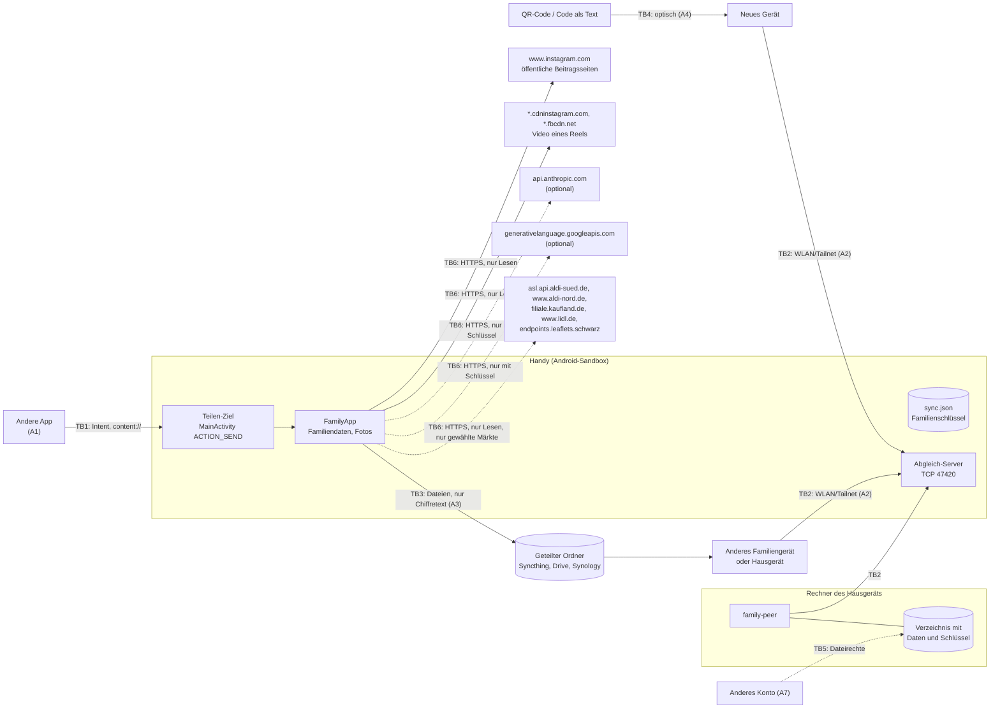

# Bedrohungsmodell: Teilen, Kopplung und Abgleich

- Stand: 26.11.2026, Code von `main` nach PR #29 und #30 plus den Härtungen aus diesem PR
- Plan-Nummer: P1-8 aus der [ISO-25010-Bewertung](iso-25010-bewertung.md)
- Bezug: [ADR 0003](../entscheidungen/0003-p2p-sync-im-selben-netz.md) (kein Server), [ADR 0006](../entscheidungen/0006-kopplung-und-abgleich-umsetzung.md) (Umsetzung von Kopplung und Abgleich)
- Methode: Datenflussdiagramm mit Vertrauensgrenzen, dann STRIDE je Element (Spoofing, Tampering, Repudiation, Information disclosure, Denial of service, Elevation of privilege). Jede Bedrohung hat entweder eine Maßnahme mit Test oder steht unter „Offen“ mit Begründung.

## 1. Was geschützt wird

| Schutzgut | Warum es zählt |
| --- | --- |
| Familiendaten: Einträge, Fotos von Briefen, Namen der Kinder, Fristen | Privat, teils über Kinder; ein Leck ist nicht rückholbar |
| Familienschlüssel (`sync.json`) | Wer ihn hat, liest und schreibt alles, auch über den geteilten Ordner |
| Wiederherstellungscode | Öffnet die verschlüsselte Sicherung |
| Verlässlichkeit der Daten | Ein untergeschobener oder gelöschter Termin ist ein verpasster Termin |
| Verfügbarkeit von Erfassen und Abgleich | „Schnell rein“ muss immer gehen, Fristen müssen auf allen Geräten ankommen |

## 2. Wer angreift

| Kürzel | Angreifer | Realistisch, weil |
| --- | --- | --- |
| A1 | Fremde App auf demselben Handy | Das Teilen-Ziel ist für alle Apps offen (gewollt) |
| A2 | Fremder im selben Netz | Gäste-WLAN, Café, Hotspot, Nachbar mit WLAN-Passwort; der Abgleich lauscht auf Port 47420 |
| A3 | Ordnerdienst oder Mitnutzer des geteilten Ordners | Google, Synology-Admin, jemand mit Freigabe auf den Ordner |
| A4 | Jemand mit Blick auf den Bildschirm | QR-Code beim Koppeln, Screenshot, Bildschirmaufnahme |
| A5 | Finder oder Dieb eines Handys | Handys gehen verloren |
| A6 | Ehemaliges Familienmitglied | Zielgruppe sind auch Getrennterziehende: das Gerät war rechtmäßig gekoppelt |
| A7 | Anderes Konto auf dem Rechner des Hausgeräts | Surface, NAS oder Mini-PC mit mehreren Nutzern |
| A8 | Kind mit eigenem gekoppelten Gerät, oder wer ein entsperrtes Familienhandy in der Hand hat | Kinder sind im Datenmodell vorgesehen; Handys werden verliehen (geplant, siehe [Kontakte und Portfolio](../kontakte-und-portfolio.md)) |

Nicht betrachtet: wer Root/Administrator auf einem Familiengerät hat oder Schadsoftware mit diesen Rechten (dagegen hilft keine App), Angriffe auf Tailscale selbst, die Update-Prüfung (eigene Prüfungen in ADR 0005), iOS (noch nicht gebaut), Lieferkette der Bibliotheken.

## 3. Datenfluss und Vertrauensgrenzen

| Grenze | Was sie trennt | Was darüber geht |
| --- | --- | --- |
| TB1 | App-Sandbox ↔ andere Apps | Text und Bilder über „Teilen“ |
| TB2 | Gerät ↔ Netz | Handshake (Klartext: Zufall, flüchtiger Schlüssel), danach nur AES-GCM-Rahmen; DNS-SD-Eintrag `_familyapp._tcp` |
| TB3 | Gerät ↔ Ordnerdienst | `familyapp-abgleich/<Geräte-ID>.fas`, `familyapp-abgleich-fotos/*.fap`, Sicherung `FAB1` |
| TB4 | Mensch ↔ Mensch | QR-Code mit Einmalgeheimnis, sechsstellige Prüfzahl |
| TB5 | Prozess ↔ andere Konten des Rechners | Dateien des Hausgeräts |
| TB6 | Gerät ↔ fremde Dienste im Internet | Abruf öffentlicher Instagram-Seiten (ADR 0007) und des Videos eines Reels (ADR 0008); optional Caption an Claude oder Caption und Video an Gemini; Wochenangebote der gewählten Märkte (Aldi Süd, Aldi Nord, Kaufland, Lidl), nach außen höchstens der Mittelpunkt des PLZ-Gebiets |

## 4. Bedrohungen und Maßnahmen

Status: ✓ abgesichert und geprüft · ◐ abgesichert mit Restrisiko · ✗ offen (siehe Abschnitt 5) · ○ geplant (Funktion noch nicht gebaut, Maßnahme ist Abnahmekriterium). **Neu** heißt: mit diesem PR eingebaut.

### Teilen (TB1, A1)

| ID | STRIDE | Bedrohung | Maßnahme | Beleg | Status |
| --- | --- | --- | --- | --- | --- |
| TE-1 | I, E | Eine fremde App schickt einen `file://`-Link oder einen Link auf den eigenen FileProvider der FamilyApp. Die App würde dann ihre eigenen Dateien (Familiendaten, `sync.json` mit dem Familienschlüssel) als „Foto“ in einen Eintrag kopieren, und der Abgleich verteilt sie (Confused Deputy) | Nur `content://`; Anbieter der eigenen App werden abgelehnt, erkannt am Namen und über den PackageManager, bei Fehler gilt der Anbieter als eigener. **Neu:** auch andere eigene Anbieter, nicht nur `.files` | `SharedInputTest.onlyContentFromAnotherAppIsOpened`; Emulator: „file://-Link …“, „Link auf den eigenen FileProvider“ | ✓ |
| TE-2 | D | Eine riesige Datei füllt Speicher und Sicherung | Kopie bricht nach 20 MB ab, egal welche Größe der Absender angibt | `SharedInputTest.copyStopsRightAfterTheLimit…`, `exactlyTheLimitIsStillAccepted`; Emulator: „21-MB-Bild abgelehnt“ | ✓ |
| TE-3 | T, D | Etwas, das kein Bild ist (HTML, APK), landet als Foto im Eintrag; ein Bild mit absurd vielen Bildpunkten bringt die Anzeige zum Absturz | **Neu:** Typ vom Anbieter (nicht vom Absender) muss `image/*` sein, danach muss der Bilddecoder aus den kopierten Bytes eine Größe lesen, höchstens 100 Megapixel | `SharedInputTest.onlyImagesAreTakenAsPhoto`, `decodedSizeDecidesNotTheClaimedType`; Emulator: „HTML-Datei abgelehnt“, „HTML mit Bildtyp abgelehnt“ | ✓ |
| TE-4 | D | Ein geteilter Text mit vielen MB bläht Daten, Sicherung und jeden Abgleich auf | **Neu:** Text auf 20 000 Zeichen gekürzt | `SharedInputTest.sharedTextIsJoinedAndCut` | ✓ |
| TE-5 | S | Eine fremde App legt ungefragt Einträge an | Gewollt („schnell rein“). Der Eintrag liegt im Eingang mit Quelle „geteilt“ und Rückgängig, Person und Datum bestätigt ein Mensch | Gestaltungsdoc, HITL-Prinzip | ◐ akzeptiert |
| TE-6 | (Verlässlichkeit) | Ein abgelehntes Bild verschwindet still, die Person glaubt, der Brief sei gespeichert | **Neu:** Meldung „Gespeichert ohne Bild. …“ mit Grund, der Text bleibt erhalten | `AppModelTest.refusedSharedImage…` (2 Tests); Emulator prüft jede Meldung | ✓ |
| TE-7 | S, T | Eine fremde App schickt Text, der wie ein Rezept aussieht, oder einen Instagram-Link; er landet ungefragt in der Kochbibliothek statt im Eingang (Kochbibliothek, 26.11.2026) | Nur Regeln entscheiden, nichts geht ins Netz: Zutatenliste **und** Schritte, oder ein Link auf einen Instagram-Beitrag mit höchstens 40 Zeichen daneben. Mit Bild bleibt es immer ein Eintrag. Landet als „Vorschlag“ mit Rückgängig, ein Mensch bestätigt | `RecipeImportTest.schoolMailIsNotARecipe`, `ingredientsWithoutStepsStayACapture`, `instagramProfileLinkIsNoRecipe`; `KitchenModelTest.recipeTextWithPhotoStaysACapture` | ✓ |
| TE-9 | S, T, I | Ein geteilter Link bringt die App dazu, eine fremde Adresse abzurufen (SSRF über das Handy) oder fremde HTML-Seiten als Rezept zu übernehmen (Instagram-Abruf, ADR 0007) | **Neu:** Abgerufen wird nur `https://www.instagram.com` mit Pfad aus dem Shortcode (`/p/<code>/` oder `/p/<code>/embed/captioned/`, Code nur `[A-Za-z0-9_-]`, höchstens 64 Zeichen); andere Pfade schickt der Abruf gar nicht ab. Keine Cookies, keine Anmeldung. Rückfall (27.11.2026): unsichtbare WebView mit denselben Pfaden, Hauptfenster nur auf `https://www.instagram.com` außerhalb `/accounts/`, sonst Abbruch; keine JavaScript-Schnittstelle zur App, kein Datei-/Content-Zugriff, Cookies danach gelöscht | `InstagramPostTest.shortcodeOnlyFromInstagramPostLinks`, `pathsAreBuiltFromTheShortcodeOnly`; `HttpInstagramPagesTest.onlyThePathsInstagramLinkBuildsAreRequested`, `normalPageIsReadWithoutCookies`; `InstagramImportTest.browserIsAskedOnlyWhenThePlainFetchGetsNoCaption` (WebView selbst nur auf dem Gerät prüfbar) | ✓ |
| TE-10 | D, T | Instagram (oder wer sich dazwischenschaltet) liefert riesige, kaputte oder umgeleitete Seiten; der Parser hängt oder übernimmt Unsinn | **Neu:** nur Status 200 und `text/html`, Weiterleitungen werden nicht verfolgt, höchstens 3 MB, 10 s Zeitlimit; JSON per Zeichenscan statt Regex, Caption höchstens 5 000 Zeichen; Ergebnis bleibt Vorschlag mit Rückgängig; hat jemand den Vorschlag schon geändert, wird nichts überschrieben | `HttpInstagramPagesTest` (Größe, Umleitung, Typ, Status), `InstagramPostTest.overlongCaptionIsRefused`, `loginWallAndForeignPagesGiveNothing`; `KitchenModelTest.recipeChangedWhileFetchingIsNotOverwritten` | ✓ |
| TE-11 | I, T | Optionale Cloud-KI (Claude oder Gemini): Familiendaten gehen an den Anbieter, der API-Schlüssel landet woanders, oder eine Caption, gesprochener Text oder eine Einblendung im Video steuert die KI (Prompt-Injection) | Aus ohne Schlüssel; der Anbieter folgt aus dem Schlüssel selbst (`AQ.…` oder `AIza…` Gemini, `sk-ant-…` Claude), unbekannte Schlüssel werden nicht gespeichert. Nur die öffentliche Caption und bei Gemini das Video eines geteilten Beitrags gehen hin, und nur wenn die Regeln keine Zutaten finden; Schlüssel nur als Header an die feste Adresse (`api.anthropic.com`, `generativelanguage.googleapis.com`), nie im Body, nicht im Abgleich. **Neu (ADR 0008):** die Upload-Adresse, die Google zurückgibt, muss auf demselben Host liegen, sonst geht das Video nicht hinaus; an die Upload-Adresse geht kein Schlüssel; Dateinamen aus Googles Antwort nur in der Form `files/[a-z0-9-]`; hochgeladene Videos werden nach der Antwort gelöscht. Antwort nur als JSON nach festem Schema, durch den Zutaten-Parser, Werte begrenzt, Ergebnis bleibt Vorschlag. Google nutzt Inhalte der kostenlosen Stufe zur Produktverbesserung: steht in den Einstellungen | `RecipeAiTest`, `GeminiRecipeRequestTest` (Schema, Fehler, Dateinamen, Anbieter am Schlüssel), `HttpClaudeRecipeAiTest.recipeComesBackWithTheRightHeaders`, `HttpGeminiRecipeAiTest.captionGoesWithTheKeyOnlyInTheHeader`, `largeVideoIsUploadedAwaitedUsedAndDeleted`, `uploadAddressOnAnotherHostIsRefused`; `KitchenModelTest.cloudAiStaysUnusedWithoutKeyOrWhenRulesSucceed`, `cloudAiReadsWhatTheRulesCannotAndItStaysASuggestion` | ◐ Schlüssel liegt unverschlüsselt im App-Speicher wie der Wiederherstellungscode (Android Keystore ist der nächste Schritt laut Plan) |
| TE-12 | S, T, D | Video eines Reels (ADR 0008): eine Adresse aus der Seite führt woandershin (SSRF), der Download füllt den Speicher, oder das Video bleibt auf dem Handy liegen | Die Adresse kommt nur aus Instagrams eigener Seite (`video_url` im Einbettungs-JSON, sonst `og:video`), nie aus dem geteilten Link, und nur `https` auf `*.cdninstagram.com` oder `*.fbcdn.net`, ohne Benutzer und Port, höchstens 4 096 Zeichen. Nur Status 200 mit `video/*`, keine Weiterleitungen, keine Cookies, höchstens 50 MB, 30 s Lesezeitlimit; abgebrochene Downloads werden gelöscht; das Video liegt nur im Cache und wird direkt nach der KI-Antwort gelöscht; nur eine KI, die Videos liest (Gemini), löst den Download aus | `InstagramPostTest.videoUrlsOnlyFromTheCdnHosts`, `videoAddressComesFromTheEmbedJsonOnlyIfItIsInstagramsCdn`; `HttpInstagramVideosTest` (Typ, Größe, Umleitung, Löschen); `KitchenModelTest.geminiWatchesTheReelAndTheVideoIsDeletedAfterwards`, `nothingInTheVideoEitherIsSaidAndTextOnlyAisNeverGetTheVideo` | ✓ |
| TE-13 | S, T, D, I | Rezeptbild (Vorschaubild eines Beitrags oder Standbild aus dem Video): eine Adresse aus der Seite führt woandershin (SSRF, Tracking), eine präparierte oder riesige Bilddatei bringt den Decoder zum Absturz oder füllt den Speicher (Dekompressionsbombe), Metadaten des Originals reisen in den Familienabgleich, viele große Bilder blähen Abgleich und Sicherung auf | Adresse nur aus Instagrams eigener Seite (`display_url`, sonst `thumbnail_src` im Einbettungs-JSON, sonst `EmbeddedMediaImage`, sonst `og:image`), dieselbe Regel wie TE-12: nur `https` auf `*.cdninstagram.com` oder `*.fbcdn.net`, ohne Benutzer und Port. Nur Status 200 mit `image/jpeg`, `image/png` oder `image/webp`, keine Weiterleitungen, keine Cookies, höchstens 10 MB, und die Bytes müssen mit der Signatur von JPEG, PNG oder WebP beginnen (SVG und alles andere fliegt vor dem Dekodieren raus). Vor dem Dekodieren wird nur die Größe gelesen: über 8 000 px je Seite wird abgelehnt, dann verkleinert dekodiert. Gespeichert wird immer ein neu kodiertes JPEG (kurze Seite ≤ 900 px, lange ≤ 1 600 px, Qualität 80, etwa 150–300 kB), nie die heruntergeladene Datei, also ohne Metadaten. Das Standbild kommt aus dem Video, das für die KI ohnehin geladen war (TE-12), vor dessen Löschen; kein eigener Download. Bild bleibt Teil des Vorschlags (Rückgängig), wird nie über ein vorhandenes Bild gelegt und geht beim Löschen des Rezepts mit | `InstagramPostTest.coverOnlyFromInstagramsCdnOverHttps`, `coverComesFromDisplayUrlElseThumbnail`; `HttpInstagramImagesTest` (Adresse, Typ, Größe, Umleitung, Signatur); `RecipePhotoTest` (Grenzen, Bombe); `KitchenModelTest.aCoverOutsideInstagramsCdnIsNeverFetched`, `withoutCoverAFrameOfTheVideoIsTakenWhereTheAiSawTheDish`; `KitchenSyncTest.recipePictureTravelsByFileName` | ◐ Dekodieren und Standbild (Android `BitmapFactory`, `MediaMetadataRetriever`) laufen nur im Emulator-Build, nicht im Qualitätstor |
| TE-8 | T, E | Geteilter oder getippter Text bringt einen Link mit anderem Schema (`intent:`, `javascript:`, `file:`), den „Quelle öffnen“ an das System gibt | Nur `http(s)://` wird als Quelle übernommen und geöffnet, alles andere bleibt Text; Tracking-Parameter (`igsh`, `utm_…`) werden entfernt | `RecipeImportTest.onlyWebLinksAreTaken`, `trackingParametersAreRemovedOthersKept` | ✓ |

### Kopplung per QR-Code (TB2, TB4, A2, A4)

| ID | STRIDE | Bedrohung | Maßnahme | Beleg | Status |
| --- | --- | --- | --- | --- | --- |
| KO-1 | S | Jemand fotografiert den QR-Code und koppelt sein eigenes Gerät | Einladende Person sieht Namen und Gerät und muss „Stimmt“ tippen; Code gilt 10 Minuten und nur einmal | `SyncControllerTest.declinedPairingTransfersNothing`, `wrongSecretExpiredAndForeignCodesFail` | ✓ |
| KO-2 | S, T | Jemand mit dem QR-Geheimnis setzt sich zwischen die Geräte | Prüfzahl aus dem ganzen Handshake (beide flüchtigen Schlüssel); ein Mittelsmann hat einen Versuch und trifft mit 1 : 1 000 000 | `SyncProtocolTest.manInTheMiddleWithTheQrSecretGetsDifferentDigits` | ◐ wirkt nur, wenn die Menschen die Zahlen vergleichen |
| KO-3 | S, D | Jemand rät das Geheimnis über das Netz oder macht den Code durch Fehlversuche ungültig | 256 Bit; erst ein bewiesenes Geheimnis verbraucht den Code, ein falsches Geheimnis oder ein Port-Scanner nicht | `SyncControllerTest.wrongSecretExpiredAndForeignCodesFail` (nach dem gefälschten Code lädt das Gerät weiter ein) | ✓ |
| KO-4 | I | QR-Code oder „Code als Text“ landet in einem Screenshot, einer Bildschirmaufnahme oder der Vorschau der letzten Apps | Wirkt wie KO-1 (Bestätigung nötig, 10 Minuten) | – | ✗ M2 |
| KO-5 | E | Der Familienschlüssel geht an ein Gerät, bevor beide zugestimmt haben | `Welcome` erst nach beiden Zusagen | `SyncControllerTest.declinedPairingTransfersNothing` | ✓ |
| KO-6 | S | Der QR-Code verweist auf ein anderes Gerät als das, mit dem man spricht | Neues Gerät prüft die Geräte-ID aus dem QR-Code | `SyncProtocolTest.joinerRefusesADeviceThatIsNotTheOneFromTheQrCode` | ✓ |

### Direkter Abgleich im WLAN oder Tailnet (TB2, A2)

| ID | STRIDE | Bedrohung | Maßnahme | Beleg | Status |
| --- | --- | --- | --- | --- | --- |
| NE-1 | I | Mithören im WLAN | AES-256-GCM, flüchtige P-256-Schlüssel je Sitzung (Forward Secrecy) | `HandshakeTest.sameSecretOpensEncryptedFramesBothWays`, `everySessionHasFreshKeys` | ✓ |
| NE-2 | S, T | Fremdes Gerät gibt sich als Familiengerät aus, verändert oder wiederholt Nachrichten | Vorab geteilter Schlüssel aus dem Familienschlüssel im Handshake (Muster Noise NNpsk0), Zählernonce je Richtung | `HandshakeTest.strangerWithoutFamilyKeyCannotOpenTheFirstFrame`, `changedOrReplayedFrameIsRejected`, `SyncControllerTest.foreignFamilyDeviceCannotSync` | ✓ |
| NE-3 | D | Ein Fremder schickt vier Bytes „Rahmen mit 32 MB“, die App reserviert den Speicher, bevor irgendein Geheimnis geprüft ist; wenige Verbindungen beenden die App | **Neu:** Bis die Gegenseite das Geheimnis bewiesen hat (die ersten zwei Rahmen), höchstens 64 KB je Rahmen | `TcpTransportTest.aHugeFirstFrameIsRefusedBeforeAnyMemoryIsReserved`, `afterTheHandshakeFramesMayBePhotoSized` | ✓ |
| NE-4 | D | Viele stumme Verbindungen halten den Server je 200 s fest | **Neu:** höchstens 8 Verbindungen gleichzeitig, wer vor dem Handshake 10 s schweigt, fliegt | `TcpTransportTest.aSilentStrangerIsDroppedQuickly`, `connectionsBeyondTheLimitAreClosed…` | ◐ ein Fremder im WLAN kann den Direktabgleich verzögern; Ordner und spätere Runden gleichen trotzdem ab |
| NE-5 | I | Erkennbarkeit: DNS-SD-Eintrag „FamilyApp“, Antwort auf einen Handshake; der Server lauscht auch im Café-WLAN | Eintrag und Handshake verraten nichts über die Familie, nur dass die App läuft | ADR 0006 | ✗ M3 |
| NE-6 | S, R | Innerhalb der Familie kann jedes gekoppelte Gerät sich als jedes andere ausgeben und `changedBy`/`doneBy` frei setzen; „wer hat erledigt“ beruht auf Vertrauen | Keine Signatur pro Gerät (bewusste Abweichung, ADR 0006) | – | ✗ M4 |
| NE-7 | T | Ein Familiengerät schickt bösartige Datensätze: Fotonamen mit `../`, übergroße Fotos | Fotonamen geprüft, Fotos ≤ 20 MB, Rahmen ≤ 32 MB | `SyncProtocolTest.photoNamesCannotEscapeThePhotoFolder`, `BackupFolderTest.photoNamesFromABackupCannotEscapeThePhotoFolder` | ◐ Anzahl der Datensätze unbegrenzt (gekoppeltes Gerät gilt als vertrauenswürdig) |
| NE-8 | T | Ungültiger Kurvenpunkt im Handshake (Invalid-Curve-Angriff) oder Müll statt Handshake | Die Krypto-Bibliothek der Plattform lehnt Punkte neben der Kurve ab, Müll scheitert am Format; ohne Familienschlüssel nützte ein Treffer ohnehin nichts, weil beide Seiten flüchtige Schlüssel verwenden | **Neu:** `HandshakeTest.publicKeyOffTheCurveIsRefused` (JDK; auf Android prüft Conscrypt/BoringSSL gleich), `garbageInsteadOfHandshakeIsRefused` | ✓ |

### Geteilter Ordner und Sicherung (TB3, A3)

| ID | STRIDE | Bedrohung | Maßnahme | Beleg | Status |
| --- | --- | --- | --- | --- | --- |
| OR-1 | I | Ordnerdienst liest die Familiendaten | Nur Chiffretext (AES-256-GCM, eigener Schlüssel per HKDF aus dem Familienschlüssel) | `SyncControllerTest.sharedFolderSyncsWithoutBothBeingOnline` („The folder only sees ciphertext“), `BackupFolderTest.nothingReadableEndsUpInTheFolder` | ◐ sichtbar bleiben Anzahl der Geräte (Dateinamen), Dateigrößen, Zeitpunkte, Anzahl Fotos |
| OR-2 | T | Dateien vertauschen, umbenennen, verändern oder eine alte Fassung zurückspielen | Dateiname als zusätzliche Authentisierung im GCM; alte Fassungen verlieren, weil pro Datensatz der neuere Stempel gewinnt | `BackupFolderTest.changedFileIsRejected`, `SyncMergeTest.newestVersionWinsAndTombstoneBeatsOlderEdit` | ✓ |
| OR-3 | D | Eine riesige Datei im Ordner füllt beim Einlesen den Speicher oder lässt jeden Abgleich scheitern | **Neu:** Lesen höchstens 32 MB pro Datei (Sicherung und Abgleich); eine zu große Abgleichdatei wird übersprungen, die anderen gleichen weiter ab | `BoundedReadTest` (4 Tests), `SyncControllerTest.sharedFolderSyncsWithoutBothBeingOnline` („Riesendatei“) | ✓ |
| OR-4 | D | Ordnerdienst löscht Dateien oder hält sie zurück | Nur Verfügbarkeit; „zuletzt abgeglichen“ steht in den Einstellungen, der Direktabgleich läuft weiter | – | ◐ akzeptiert |

### Hausgerät (TB5, A7)

| ID | STRIDE | Bedrohung | Maßnahme | Beleg | Status |
| --- | --- | --- | --- | --- | --- |
| HG-1 | I | Ein anderes Konto auf dem Rechner liest `sync.json` (Familienschlüssel) und die Familiendaten | **Neu:** `sync.json` entsteht mit `rw-------` (vor dem ersten Byte), das Verzeichnis bekommt `rwx------`; README empfiehlt Festplattenverschlüsselung | `SyncFilesTest.theFileWithTheFamilyKeyIsReadableByItsOwnerOnly` | ◐ Administrator liest alles, Daten liegen unverschlüsselt auf der Platte |
| HG-2 | S, D | Hausgerät ist dauernd erreichbar und damit dauernd Ziel von NE-3 bis NE-5 | Dieselben Maßnahmen wie NE-3/NE-4; README: Port nur im LAN/Tailnet, Tailscale-ACL auf Familiengeräte | `TcpTransportTest` | ◐ |

### Kontakte (TB1, A1; Stufe 1 umgesetzt 27.11.2026)

| ID | STRIDE | Bedrohung | Maßnahme | Beleg | Status |
| --- | --- | --- | --- | --- | --- |
| KT-1 | D, T | Eine fremde App teilt eine riesige oder kaputte vCard (eingebettetes Foto als Base64, tausende Kontakte in einer Datei) | vCard höchstens 1 MB, `PHOTO` und unbekannte Felder werden verworfen, höchstens 20 Kontakte je Vorgang, Feldlängen begrenzt; landet mit Rückgängig. Eine geteilte Datei nur von fremdem `content://`-Anbieter (wie TE-1), Lesen bricht nach 1 MB ab | `VCardTest.kt1_tooLargeFileIsRefusedBeforeParsing`, `kt1_atMostTwentyContactsPerShare`, `kt1_cardsWithoutNameNumberOrOrganisationAreSkipped`, `kt1_longFieldsAreCutAndValuesCapped`; `SharedInputTest.kt1VCardFileOnlyFromAnotherAppsProvider`; `PeopleModelTest.sharedVCardMessagesSayWhatHappened` | ◐ Emulator-Teilen-Test mit vCard fehlt noch |
| KT-2 | T, E | Eine vCard bringt `URL`/`TEL`-Werte mit fremdem Schema (`intent:`, `javascript:`), oder eine Nummer mit Steuercodes (`*#…#`), die beim Antippen ausgeführt würden | Links nur `http(s)://` (wie TE-8); Nummern nur Ziffern, `+`, Leerzeichen; Anrufen nur über `ACTION_DIAL` (Wähl-App zeigt die Nummer, nichts wird ohne Tap gewählt), keine `CALL_PHONE`-Berechtigung | `ContactRulesTest.kt2_dialableKeepsOnlyDigitsAndLeadingPlus`, `VCardTest.kt2_serviceCodesAndForeignSchemesDoNotSurvive`, `PeopleModelTest.otherAppsGetOnlySafeValues`; `verify-apk.sh` (CALL_PHONE) | ✓ |
| KT-3 | I | Die App liest mehr aus dem Telefonbuch als nötig oder behält Zugriff | Keine `READ_CONTACTS`/`WRITE_CONTACTS`; Systemauswahl (`ACTION_PICK_CONTACTS` ab API 37, sonst `ACTION_PICK`) mit vorübergehendem Leserecht nur auf die gewählten Kontakte und nur angefragte Felder | `verify-apk.sh` lehnt eine APK mit diesen Berechtigungen ab. Umgesetzt ist `ACTION_PICK`; `ACTION_PICK_CONTACTS` folgt mit API 37 | ✓ |
| KT-4 | I | Kontaktdaten Dritter verlassen die Familie über einen Online-Dienst (Cloud-KI, Abruf) | Kontakte und Portfolio werden nie an Cloud-KI oder andere Dienste gegeben, unabhängig von Einstellungen | `KitchenModelTest.cloudAiReadsWhatTheRulesCannotAndItStaysASuggestion` (Familie mit Kontakt und Info, die KI bekommt nur die Bildunterschrift); im Code gibt es keinen Weg von Kontakten zu einem Netzaufruf | ✓ |
| KT-5 | I | „Ins Telefonbuch“ macht einen Familienkontakt für alle Apps mit Kontaktzugriff (Messenger) lesbar | Nur einzeln auf Tap über den System-Dialog (`ContactsContract.Intents.Insert`), Hinweis dauerhaft unter dem Knopf | `PeopleModelTest.otherAppsGetOnlySafeValues` | ◐ akzeptiert |

### Wochenangebote der Märkte (TB6; Stufe 1b umgesetzt 27.11.2026, Stufe 2a mit Penny, Norma, Netto und denn's am 27.11.2026)

Neuer Eingang: Antworten von neun fremden Hosts ([Angebote, Saison und Essensvorschläge](../angebote-und-vorschlaege.md)). Dazu kommt der Grundsatz von Nils vom 27.11.2026: Bot-Abwehr wird nie umgangen, ein Markt, der ablehnt, wird abgeschaltet (AN-5).

| ID | STRIDE | Bedrohung | Maßnahme | Beleg | Status |
| --- | --- | --- | --- | --- | --- |
| AN-1 | D | Ein Markt (oder wer sich dazwischen schiebt) liefert eine riesige oder endlose Antwort, oder leitet weiter | Nur HTTPS zu neun festen Hosts ([Marktprüfung](../angebote-maerkte.md)), keine Weiterleitung, HTML höchstens 5 MB (Kaufland-Seite 3,8 MB), JSON höchstens 2 MB, nur die Penny-Filialliste höchstens 6 MB (etwa 4 MB), Lesen bricht nach der Grenze ab, 15 s Zeitlimit | `HttpMarketsTest.an1_redirectsAreNotFollowed`, `an1_tooLargeAnswersAreDropped`, `MoreMarketsTest.newHostsAreAllowedAndNothingElse_an1` | ✓ |
| AN-2 | T, D | Kaputte oder feindliche Antwort: falsche Typen, tief verschachteltes JSON, Skripte, Links, sehr lange Namen | Antworten werden nur als JSON/Text gelesen, nie ausgeführt; nur Text- und Zahlenfelder, keine Links und keine Bilder; Titel auf 160 Zeichen gekürzt; Verschachtelung höchstens 40 Ebenen; unbekannte Form ergibt eine leere Liste, nie einen Absturz | `MarketParsersTest.an2_*` | ✓ |
| AN-3 | I | Die Wohnadresse verlässt das Handy (an Märkte oder einen Geocoder) | Kein Geocoder; Adresse bleibt auf den Familiengeräten, benutzt wird nur die PLZ über die mitgelieferte GeoNames-Tabelle; nach außen geht nur der PLZ-Mittelpunkt (auf 0,01° gerundet) an die Kaufland-Filialsuche; keine Cookies, die Kennung der App enthält keine Geräte- oder Familiendaten | `MarketFetchTest.an3_kauflandGetsOnlyThePostcodeCentreAndOffersAreFilteredToTheStore`, `OffersModelTest.firstPlaceSuggestsMarketsAndReadsThemOnWlan`, `HttpMarketsTest.an5_normalAnswerWithAnHonestLabelAndNoCookies` | ✓ |
| AN-4 | T, E | Eine Antwort schiebt der App eine andere Adresse unter (Filialnummer oder Prospekt-ID mit `../` oder fremdem Host) | Adressen nur aus festen Mustern; Filialnummer nur `^[A-Z]{2}\d{3,6}$`, Prospekt-ID nur `aktionsprospekt-…`, höchstens 3 Prospekte; jeder Abruf prüft den Host gegen die feste Liste | `MarketFetchTest.an4_storeIdsFromAnAnswerNeverBuildOtherUrls`, `an4_lidlLeafletIdsAreCheckedAndCapped`, `an4_everyUrlGoesToAnAllowedHost`; `HttpMarketsTest.serverErrorsAndForeignHostsAreFailures` | ✓ |
| AN-5 | S (Rechtsrahmen) | Die App umgeht Bot-Abwehr oder tarnt sich als Browser | Ehrliche Kennung `FamilyApp (…)`, keine Browser-Kennung, keine WebView, kein Captcha; 401/403/429 oder eine Challenge-Seite schaltet den Markt ab („… lässt sich gerade nicht automatisch lesen“), kein zweiter Versuch mit anderen Mitteln; nur die Person kann „Nochmal versuchen“ (dieselbe Anfrage) | `HttpMarketsTest.an5_*`, `MarketFetchTest.an5_refusalStopsTheMarketAtOnce`, `OfferCacheTest.an5_refusedStaysOffWhateverTheAge`, `OffersModelTest.an5_refusedMarketIsSwitchedOffUntilThePersonAsksAgain`, `MoreMarketsTest.pennyRefusalStopsAtOnce_an5` | ◐ Prüfung 1 auf dem echten Handy steht aus |
| AN-6 | T, D | Ein Familiengerät mit neuerer App schickt einen unbekannten Markt, oder die „Passt nicht“-Liste wächst ohne Ende | Märkte als Namen gespeichert, unbekannte werden übersprungen statt die Familiendaten unlesbar zu machen; höchstens 500 „Passt nicht“, die ältesten gehen zuerst; Bezeichnung des Orts höchstens 120 Zeichen | `KitchenSyncTest.an6_marketUnknownToThisVersionIsSkippedNotFatal`, `an6_passtNichtListStaysBounded` | ✓ |
| AN-7 | D | Die lokale Angebotsdatei ist kaputt oder stammt aus einer anderen Version | Datei liegt getrennt von den Familiendaten (`angebote.json`, nicht in der Sicherung); unlesbar heißt leer, der nächste Abruf füllt sie wieder | `OfferCacheTest.an7_storedCacheRoundTripsAndBrokenFilesStartEmpty` | ✓ |
| AN-8 | T, D | Angebotstext landet in den abgeglichenen Familiendaten (Familie › Einkauf, „Auf die Liste“, 27.11.2026) und reist so auf alle Geräte | Nur auf Tippen einer Person (kein automatisches Übernehmen); Name als reiner Text, höchstens 160 Zeichen, auch wenn ein Parser die Grenze aus AN-2 verfehlt; Markt und Preis nur als Hinweistext am Eintrag | `KitchenModelTest.an8_marketTextEntersTheFamilyListOnlyOnATapAndBounded`, `offerGoesOnTheListWithMarketAndPriceAndUndo` | ✓ |
| AN-9 | T, E | Die Penny-Filialliste oder die Angebotsseite schiebt der App über Filialnummer, Verkaufsregion oder Kategorie eine andere Adresse unter (`../`, `?`, fremder Host) | Werte aus einer Antwort kommen nur in eine Adresse, wenn sie zum Muster passen: Filiale `^\d{3,8}$`, Region `^[0-9A-Z-]{1,20}$`, Kategorie `^[a-z0-9-]{1,60}$`, Woche `JJJJ-WW`, höchstens 20 Kategorien; Norma-Tagesseiten nur `/de/angebote/ab-…,-TT.MM.JJ/`, höchstens 6; Netto nur fünf feste Seiten | `MoreMarketsTest.pennyStoresKeepOnlyCleanIdsAndRegions_an9`, `pennyWeekTakesThisWeeksFoodCategoriesForCooking_an9`, `normaReadsProductBoxesAndDayPages`, `nettoReadsItsFoodPagesOnly` | ✓ |
| AN-10 | D (für den Markt), S (Rechtsrahmen) | Mehr Märkte heißen mehr Anfragen; Penny braucht je Woche bis zu 20 Kategorie-Abrufe, die App könnte wie ein Ansturm wirken | Höchstens eine Anfrage je Sekunde an denselben Host, alle Anfragen nacheinander; Abruf nur im WLAN und nur, wenn die Woche wechselt oder die Person tippt; nur die Märkte, die die Familie angehakt hat | `HttpMarketsTest.politeAtLeastOneSecondBetweenRequestsToTheSameHost`, `OffersModelTest.pennyStoreIsTakenForTheFamilyAndAnotherCanBeChosen` (Filialwechsel liest nur Penny neu) | ✓ |

### Geschützte Einträge im Portfolio (A4, A5, A6, A8; geplant)

| ID | STRIDE | Bedrohung | Maßnahme | Beleg | Status |
| --- | --- | --- | --- | --- | --- |
| TR-1 | I | Wer das entsperrte Handy hält (A8), liest Fahrradschloss- oder Spindcodes | Werte verdeckt; Anzeigen nur nach Biometrie oder Gerätesperre (Keystore-Schlüssel mit Nutzer-Authentisierung, 5 Minuten), Wert 30 s sichtbar | Emulator-Test: Wert erst nach Gerätesperre | ○ |
| TR-2 | I | Kindergerät (A8) oder Hausgerät liest Codes anderer Personen | Eigener Tresor-Hauptschlüssel nur für Erwachsenengeräte, beim Koppeln in `Welcome` übergeben, nie über den Abgleich; Kindergerät bekommt nur den eigenen Personenschlüssel (HKDF), Hausgerät keinen | Unit-Test: Kindergerät öffnet fremden Code nicht | ○ |
| TR-3 | I | Wer den Familienschlüssel hat (verlorenes Handy, Ordnerdienst mit geleaktem Schlüssel), liest Codes | Codes zusätzlich mit Personenschlüssel versiegelt (AES-256-GCM); der Abgleich bewegt nur Chiffretext | Unit-Test: Ordnerdatei und Hausgerät enthalten keinen Codewert | ○ |
| TR-4 | T | Ein Familiengerät hängt einen versiegelten Code an eine andere Person oder einen anderen Eintrag | AAD = Eintrags-ID, Personen-ID, Schlüsselversion | Unit-Test: umgehängter Datensatz scheitert an GCM | ○ |
| TR-5 | I | Screenshot, Bildschirmaufnahme, Vorschau der letzten Apps (A4) | `FLAG_SECURE`, solange ein Wert sichtbar ist (gleiche Technik wie M2) | Emulator: Fensterflag geprüft | ○ |
| TR-6 | I | Kopierter Code bleibt in der Zwischenablage, andere Apps oder Tastaturen lesen ihn | `ClipDescription.EXTRA_IS_SENSITIVE` (Android 13+), Zwischenablage nach 60 s leeren | – | ○ |
| TR-7 | I | Code erscheint in Benachrichtigung, Suche, Notfallblatt oder Sicherung im Klartext | Nur Bezeichnungen sind suchbar, nie in Benachrichtigungen; Notfallblatt nur nach ausdrücklicher Auswahl; Sicherung enthält versiegelte Werte plus den Tresorschlüssel des Geräts, beides unter dem Wiederherstellungscode | Unit-Test: Sicherung ohne Codewert im Klartext, Wiederherstellung öffnet ihn | ○ |
| TR-8 | I, E | Ehemaliges Familienmitglied (A6) behält den Tresorschlüssel | Wie GE-1: erst mit M1, das auch den Tresorschlüssel wechselt und alle Codes neu versiegelt (Schlüsselversion im Format von Anfang an) | – | ✗ M1 |
| TR-9 | I | Familien speichern Passwörter und Karten-PINs, die in einen Passwortmanager gehören | Hinweis bei Bezeichnungen wie „Passwort“, „Kennwort“, „PIN Karte“; Portale als Link + Benutzername + Verweis auf den Passwortmanager | – | ○ akzeptiert |

### Gerät (A5, A6)

| ID | STRIDE | Bedrohung | Maßnahme | Beleg | Status |
| --- | --- | --- | --- | --- | --- |
| GE-1 | I, S | Verlorenes Handy oder ehemaliges Familienmitglied: das Gerät behält den Familienschlüssel und kann weiter lesen und schreiben, über den geteilten Ordner sogar von überall | Keine (ADR 0006, „Grenzen“). Bildschirmsperre des Handys schützt nur vor dem Finder | – | ✗ M1, **höchstes Restrisiko** |
| GE-2 | I | Ab Android 12 kopiert der Umzug auf ein neues Handy den App-Speicher trotz `allowBackup="false"`. Das neue Handy hätte denselben Familienschlüssel und dieselbe Geräte-ID; beide überschreiben sich im geteilten Ordner gegenseitig die Datei | **Neu:** `dataExtractionRules` schließen Cloud-Sicherung und Umzug aus; ein neues Handy wird per QR-Code gekoppelt | `verify-apk.sh` prüft `allowBackup=false` und `dataExtractionRules` in jeder APK | ✓ |

## 5. Offen

| # | Maßnahme | Gegen | Warum noch nicht | Wann |
| --- | --- | --- | --- | --- |
| M1 | **Gerät entfernen mit Schlüsselwechsel**: neuer Familienschlüssel, verteilt nur an die übrigen Geräte, neuer Ordnerschlüssel, alte Ordnerdateien ersetzt; sobald es Codes gibt, auch neuer Tresorschlüssel | GE-1, NE-6, TR-8 | Braucht Bedienkonzept (wer darf entfernen, was passiert mit einem Gerät, das gerade offline ist) und Protokollerweiterung | Vor der Weitergabe an weitere Familien; für Getrennterziehende Voraussetzung |
| M2 | `FLAG_SECURE`, solange QR-Code oder Code als Text sichtbar sind (kein Screenshot, leere Vorschau in den letzten Apps) | KO-4 | Klein; gehört in den Kopplungsbildschirm, der gerade in einem anderen Thread geändert wird | Mit der nächsten Änderung am Kopplungsbildschirm |
| M3 | Direktabgleich nur in vertrauten Netzen: beim Koppeln gesehenes Heim-WLAN und Tailscale, sonst Server aus; gleichzeitig die Android-16-Berechtigung „Geräte im lokalen Netz“ | NE-5, NE-4 | Ändert Bedienung und hängt an der offenen Android-16-Frage aus ADR 0006 | Mit der Android-16-Berechtigung |
| M4 | Geräteschlüssel und Signatur pro Datensatz | NE-6 | Ed25519 erst ab API 33; P-256-ECDSA ginge ab API 26 | Mit P2-2 |

## 6. Wie geprüft wird

- `tools/quality-check`: `gradle check` führt alle oben genannten Unit-Tests aus (auch echte Sockets auf localhost für NE-3/NE-4 und echte Dateien für OR-3/HG-1).
- CI-Emulator (Android 8 und 16): `app/scripts/emulator-share-e2e.sh` spielt fremde Apps. `adb` schickt einen `file://`-Link und einen Link auf den eigenen FileProvider; die Test-App `app/e2eShareSource` teilt wie eine echte Galerie (eigener Anbieter, Leserecht per Intent) ein 21-MB-Bild, eine HTML-Datei und HTML mit Bildtyp. Jede Ablehnung muss mit Grund auf dem Bildschirm stehen; ein echtes Bild muss als Foto im Eingang erscheinen. Bericht `pruefbericht-teilen-api<NN>.txt` am Release.
- `app/scripts/verify-apk.sh` prüft in jeder APK `allowBackup=false` und `dataExtractionRules` (GE-2).

## 7. Pflege

Dieses Dokument wird angepasst, wenn ein neuer Eingang dazukommt (z. B. Mail-Abruf, Widget, Relay aus ADR 0002), sich ein Format oder der Handshake ändert, oder eine Maßnahme aus Abschnitt 5 umgesetzt ist. Neue Tests oder Prüfungen, die eine Bedrohung abdecken, nennen ihre ID im Kommentar (Suche nach `TE-`, `NE-`, `OR-`, `HG-`, `GE-`, `KT-`, `TR-`, `AN-`).
